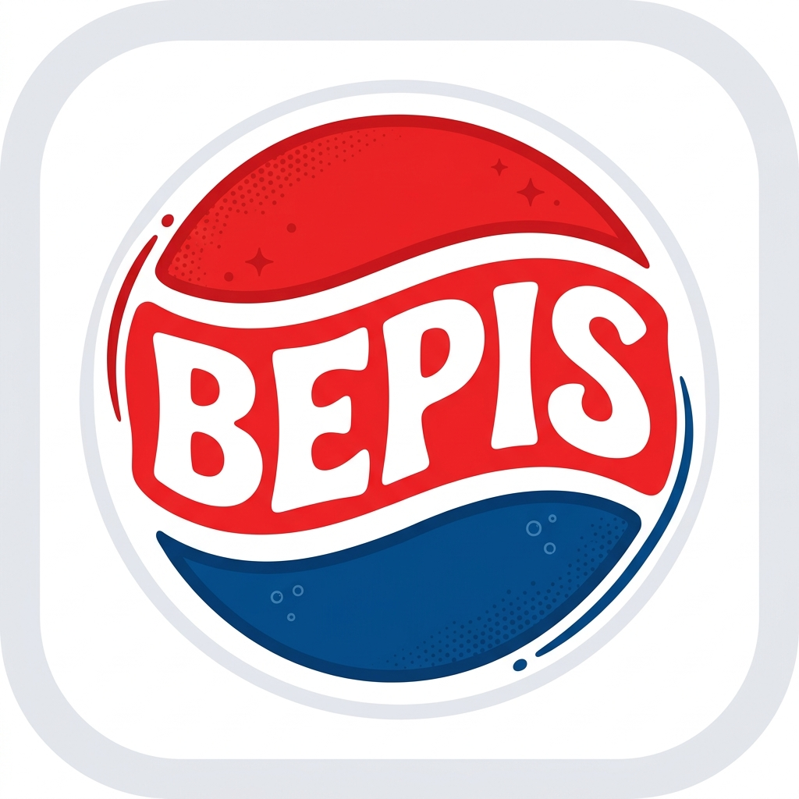

# 🥤 BepisLoader

**English** · [Русский](README.ru.md) · [हिंदी](README.hi.md)



**BepisLoader 2.3.5** is a native macOS mod-management application with a framework-agnostic architecture supporting BepInEx workflows and expanding toward Reloaded-II. It installs and manages mods for Windows games running through compatibility layers and integrates with Steamac for SteamOS VM workflows. It is specifically designed to handle the complexities of macOS compatibility layers like **CrossOver**, **CrossOver Preview**, **Whisky**, **GameHub**, **Wineskin**, and **Porting Kit**.

[Download BepisLoader 2.3.5](https://github.com/KiwiSingh/BepisLoader/releases/tag/v2.3.5) · [All releases](https://github.com/KiwiSingh/BepisLoader/releases)

---

## 🚀 Key Features

| Feature | Details |
|---|---|
| **Universal Bottle Scanning** | Automatically detects bottles in CrossOver (including Preview builds), Whisky, GameHub, Wineskin, Porting Kit, and `~/.wine`. |
| **External SSD Support** | Reads GameHub's `game_container_store.json` and resolves `dosdevices/` symlinks to find games installed anywhere, including external APFS/ExFAT drives. |
| **Mono & IL2CPP Support** | Auto-detects the Unity backend and downloads the correct BepInEx build — stable 5.x for Mono, bleeding-edge 6.x for IL2CPP. |
| **Per-Layer Config Patching** | Patches `cxbottle.conf` (CrossOver), `bottle.plist` (Whisky), `game-settings/<hash>.json` + Wine registry (GameHub), `wine.cfg` (Porting Kit), and `Info.plist` (Wineskin) so mods load automatically when you hit Play. |
| **Direct Env Injection** | For GameHub, BepisLoader injects `DOORSTOP_ENABLE`, `DOORSTOP_INVOKE_DLL_PATH`, and mandatory Mono runtime paths directly into the `environment` dictionary in GameHub's settings JSON for maximum reliability. |
| **Auto-Quarantine Removal** | Automatically runs `xattr -rs com.apple.quarantine` on all BepInEx files to prevent macOS "Developer cannot be verified" errors. |
| **Mod Manager** | Install `.dll` plugins by file picker; handles macOS security scoping for external drives; reads `[BepInPlugin]` metadata for display. |
| **Steamac Integration** | Discover SteamOS games, inspect Proton and Windows architecture, deploy BepInEx, and review framework installation and recovery evidence through the guest bridge. |
| **Asset Mods** | Game-agnostic **Install asset mod…** / **Disable asset mods** controls select a supported adapter. The first adapter combines Digimon Story Time Stranger asset replacements and compiles MBE table edits while its x64 game runs under ARM64 Proton. |
| **Checked Publication** | Asset packages reject executable mod payloads, unsupported dependencies, symlinks, conflicting paths and oversized files. The guest verifies the pinned game build and loader before publishing without replacing existing files. |
| **Multi-Framework Architecture** | Framework-neutral game and mod management with Reloaded-II installation and dependency-management infrastructure. |

---

## What's new? (v2.3.5)

2.3.5 introduces full compatibility with Steamac 1.9 and streamlined launcher handoff:
- **Steamac 1.9 Compatibility**: The guest handshake now recognizes and pairs seamlessly with Steamac 1.9 (`v1.9-kiwi.1` and upstream `fxgl/steamac`), preventing version mismatch rejection.
- **Steamac Window Focus**: When launching games via the Steamac Cockpit ("Launch via Steamac"), window focus is now reliably handed off to FX Steam Launcher (Steamac) without being re-stolen by BepisLoader.
- **Proton Prefix Rediscovery**: Added dedicated **Rediscover Active Prefix** functionality to synchronize and refresh Proton prefix paths and active runtimes with BepisLoader mod management on demand.
- **Updated Cockpit Diagnostics**: Reflects verified modded launch readiness (`Modded launch: Available`) when connected to the Steamac guest bridge.
- **Steamac Navigation**: Added a quick-access **🐸 Steamac** Cockpit button to the main sidebar for instant navigation to the Steamac management cockpit.

2.3.3 fixes an audio-bank layout incompatibility where music mods with direct ACB folders under `Ryo/Digimon Story Time Stranger/` (such as *Hololive Covered by Hololive Randomizer*) had their tracks skipped during compilation. Audio paths are now normalized to the `Ryo/Digimon Story Time Stranger/bgm/` hierarchy expected by Steamac's guest compiler, ensuring all replacement HCA tracks and YAML volume settings are properly recognized and built into custom sound banks.

2.3.2 baked in dependency support for **Ryo Framework** (`DSTS.RyoFramework`, `Ryo.Reloaded`, `SharedScans.Reloaded`) and **DSTS Mod Tools** (`DSTS.ModTools`, `DSTS.ModLoader`) into BepisLoader's asset mod adapter.

2.3.1 adds automatic ReShade setup and a dedicated ReShade mod importer, ZIP/RAR/7z imports, 1 GiB mod/profile limits with 128 MiB files, guest-side profile composition and verified table/music reuse. Adding mods reads existing manifests before review. Pair it with [Steamac Kiwi Build 8](https://github.com/KiwiSingh/steamac/releases/tag/v1.7.6-kiwi.8) and restart its VM. Steam launch options remain a manual one-time step: copy the combined setting BepisLoader presents, preserving other environment settings and arguments. The app-bundle audit passed.

The Steamac cockpit can add multiple asset mod folders and manage a persistent per-game profile. **Manage asset mods…** lists installed mods, enables/disables individual mods, removes them from the profile, and changes their priority. Mods lower in the list win conflicts; the Apply review lists every conflict and its winner.

The matching Steamac build must advertise `assetModProfilesV1` (Kiwi Build 6). Applying a profile validates stored packages, builds an immutable combined snapshot and atomically switches the guest's `.bepis-assets-active` link. Set the reported Steam Launch Options once to this stable path; subsequent profile changes do not require new launch options. Keep Steam open, close the game before applying, then restart it. All-disabled profiles load no replacements. Old package folders and previous snapshots are retained.

Previous single-package installs are imported into the first profile **disabled** for explicit review. Enable the desired mods and replace the previous package-specific launch path with the stable setting once. The profile is stored in the SteamOS game folder, so closing BepisLoader does not lose it. Limits: 64 mods and 1 GiB of referenced package snapshots; active assets also retain the 4096-file/128-MiB-per-file limits.

**Install Plugins…** in the Steamac cockpit accepts multiple BepInEx DLLs. The entire selection is snapshotted and checked for duplicate names and existing destinations before uploads begin. Every published DLL is verified; a late failure reports the successfully verified subset and stops without deleting it. The local bottle BepInEx picker already supports multiple files.

### Faster asset-mod management

The asset-mod manager reads the persisted JSON profile and package manifests to display installed mods, asset counts and priority conflicts. Opening it no longer downloads every replacement asset from the VM. Applying changes still reads and verifies the stored files and publishes a checked combined profile. Reopening the manager reads the current JSON metadata, so changes made by another client are visible.

### ReShade installation and launch settings

In the Steamac game view, choose **Launch options…**, check **Include ReShade (Direct3D / DXGI)**, and paste the value of an existing `WINEDLLOVERRIDES` entry if another loader needs it. BepisLoader presents one combined entry with `dxgi=n,b`, `d3dcompiler_47=n,b`, and the other loader overrides. An active managed asset profile also includes its stable root, executable hash and `winmm=n,b`. Keep other environment settings and command arguments when copying the result into Steam. Choices are remembered for the current BepisLoader session.

Choose **Set up ReShade…** to download and install the pinned official ReShade 6.8.0 x64 runtime and Microsoft shader compiler for a Windows x64 Direct3D / DXGI game. This creates an empty preset; install a mod to add effects. Runtime binaries are downloaded on demand rather than bundled.

Choose **Install ReShade mod…** and select a ZIP/RAR/7z archive or extracted mod folder. BepisLoader extracts archives, lets you choose a preset and Down-arrow toggle, and supplies a missing runtime and compiler automatically. Packages with addons receive the addon-enabled runtime when setting up a missing runtime. An existing valid ReShade runtime is retained when the package does not supply one. Close the game before installing; Steam can stay open. Copy the presented combined launch options into Steam manually.

The checked installer preserves the asset profile and unrelated game files, keeps backups when updating its own unedited files, and stops on conflicting or user-edited files. **Back up and replace existing ReShade settings** explicitly permits replacing `ReShade.ini` when a valid ReShade runtime is already present; it preserves the old settings in a backup. A saved guest receipt lets Launch options… and subsequent asset-profile updates include managed ReShade after BepisLoader restarts. Archive imports are limited to 1 GiB expanded / 4,096 files and 128 MiB per file. Apps run from an external volume keep download and extraction staging beside the app.

Launch options… alone configures already installed loaders; it does not install files or establish support for arbitrary Reloaded-II plugins. Digimon was tested with ReShade 6.3.3 and ShaderToggler 1.2.1: all 21 included effects compiled after adding the Microsoft x64 compiler. Shader packs using a different graphics API need separate integration.

### Larger combined profiles and additional data mods

Combined asset profiles support up to **1 GiB** of stored inputs and published assets, with 64 mods and 4,096 replacement files. Individual imported packages are limited to 1 GiB and individual files to 128 MiB. This requires the matching updated Steamac guest; older builds reject profiles above 256 MiB. Finder `.DS_Store` metadata is excluded from asset imports.

Skip Opening Logos uses an animation replacement plus opening-flow table edits. Water Recolor adds new Digimon slots through model, texture, animation, evolution and localized text assets, including appended table rows. Both use the existing data-only adapter and table compiler. The full seven-mod fixture compiled 84 tables and 17 music banks; the opening-logo skip, Water Recolor and existing costume, DigiRide and music mods were confirmed working together in live ARM64 Proton gameplay.

ReShade installer validation: package and installer regression checks passed, including the actual Digimon RAR, an actual asset 7z, wrapped ZIP imports, automatic fresh setup, pinned standard/addon runtime downloads, portable paths, Down-arrow configuration, pinned SDK download and architecture checks. Archive traversal, links and conflicting names are rejected. An isolated SteamOS fixture installed all 86 package/compiler files, updated a preset with a retained backup, and preserved the asset loader/profile. Live gameplay of the new UI installation flow remains a separate check; earlier manual ReShade installation was confirmed working.

### Faster Apply

The matching Steamac guest composes profiles locally: Apply reads stored package manifests and sends the profile settings, leaving existing mod payloads in the VM. Tables and music banks reuse verified outputs from the previous active profile when their compiler, original game data and ordered inputs match. Unchanged profiles retain their active snapshot; changing priorities or enablement still updates the saved profile. Source/output verification and atomic activation remain enforced. Older guests fall back to the full-transfer flow. The first Apply after upgrading populates compilation receipts; subsequent compatible changes reuse them.

Adding asset mods reads installed manifests rather than downloading their payloads before review. Import progress identifies each selected archive/folder. Apply performs the full guest verification and combined-size check before activation.

MBE CSV support now compiles the original game tables, merges changed cells in enabled-mod order, and appends `.ap.csv` rows afterward. Distinct cell edits coexist; later mods win competing edits. Requires Steamac with `assetMbeTablesV1`. Whole MBE replacements mixed with CSV edits to the same table are rejected for review. The native adapter resolves the managed stable folder before snapshotting its assets.

DigiRide's actual package compiled nine MBE tables and passed isolated checked publication alongside both costume mods, including pinned loader migration. Chronomon and Parallelmon riding, plus the Kanan/Inori replacements, were confirmed together in live gameplay through the stable asset root. App bundle audit passed.


## 🐸 What's new in v2.1.0

- **Verified ARM64 SteamOS texture replacement:** the FMC Eyes Green mod rendered green eyes in the x64 Digimon Story Time Stranger game under Proton 11.0 ARM64. The native loader logged replacement of the exact eye texture; the result was confirmed visually in gameplay.
- **Game-agnostic asset installation:** choose a ZIP, RAR or 7z archive, or an extracted mod folder, in the Steamac cockpit. BepisLoader selects the adapter, snapshots validated assets, uploads through `bepis.sock`, and requests guest-enforced publication. Steam can remain open; the game must be closed.
- **Independent native MVGL adapter:** no Reloaded-II or .NET hosting is needed for supported asset mods. The game payload stays Windows x64; the coordinating Linux tools support ARM64 and x64 separately.
- **Steamac safety and recovery work:** payload hashing, release/provenance discovery, bounded guest recovery inventories, recovery-scope planning, host recovery rehearsals, and transactional installer checks remain in place. Static inventory and host rehearsals are not presented as live recovery or injection proof.
- **Interface cleanup:** developer diagnostic buttons are removed; missing guest capability, executable, architecture and Proton settings now have separate actionable errors.
- **Release packaging:** universal Intel/Apple Silicon macOS application, bundled adapter licenses and source references, and the app icon injected automatically by `inject_icon.sh`.

### Asset-mod setup and limits

1. Use a Steamac build advertising `assetModInstallV1` ([Steamac Kiwi Build 8](https://github.com/KiwiSingh/steamac/releases/tag/v1.7.6-kiwi.8)). Older bridges reject installation safely; copying the macOS app alone does not update the guest agent.
2. Close the game, leave Steam open, select it in BepisLoader's Steamac cockpit, and choose **Install asset mod…**. Select a ZIP/RAR/7z archive or the extracted folder containing `ModConfig.json` and `dsts-loader/`. Archives are extracted automatically; filenames are preserved. No separate extraction utility is required.
3. **Manual launch setting required:** copy the exact setting from BepisLoader's installation report into Steam → game Properties → Launch Options. It includes the installed asset path, executable hash, and `WINEDLLOVERRIDES='winmm=n,b'`. Preserve any existing options; conflicting Wine overrides need reconciliation. BepisLoader does not change Steam's settings automatically.
4. Start the game with Steam's **Play** button. **Disable asset mods** parks the checked native adapter; assets are retained. Remove the BepisLoader launch setting when it is no longer needed.

The first adapter supports one selected asset package per launch for **Digimon Story Time Stranger**, AppID `1984270`, with executable SHA-256 `ff9de825a543bf874cfb7e73ed951256d3ce4e8702957afa3b26ca6487a81688`. It preserves asset filenames and bytes exactly, without extension, texture-directory or DDS-header restrictions. Exact filenames are matched first; `.img` requests can also fall back to `.dds` replacements. Other builds and games require their own verified adapter; unsupported ones stay blocked. Assets are snapshotted at launch, so edits require restarting the game. The generic controls do not claim universal game compatibility.

Full Reloaded-II / managed-plugin initialization under ARM64 Proton remains unresolved. This release validates the independent texture-replacement path, not every mod loader or mod type. Existing generic launch-reservation and installation safety gates remain fail closed.

## 🛠 Installation & Usage

1. **Download**: Download and extract [BepisLoader-v2.3.5-macOS-universal.zip](https://github.com/KiwiSingh/BepisLoader/releases/download/v2.3.5/BepisLoader-v2.3.5-macOS-universal.zip).
2. **Select Game**: The app will scan your bottles automatically. If your game is on an external drive, use the **"+ Add Game → From Mac / External Drive"** option.
3. **Install**: Click **"Install BepisLoader"**. It will download the correct BepInEx version, configure your Wine registry, and patch your compatibility layer's config files.
4. **Add Mods**: Use **"+ Add Mod…"** to install `.dll` plugin files into the game's `BepInEx/plugins/` folder.
5. **Launch**:
   - **IMPORTANT**: Launch the game **directly through your compatibility layer** (CrossOver, Whisky, GameHub, etc.)
   - **IL2CPP Games**: On the very first launch, you may see a black screen for 10-30 seconds. **Do not close the game.** BepInEx is generating interop assemblies (check `BepInEx/LogOutput.log` to see progress). Subsequent launches will be instant.

---

## 🏗 Building from Source

```bash
# Clone the project
git clone https://github.com/KiwiSingh/BepisLoader
cd BepisLoader

# Build the .app bundle using the included script
chmod +x build_app.sh inject_icon.sh
./build_app.sh

# build_app.sh also runs inject_icon.sh automatically.
# To reinject the icon into an existing bundle:
./inject_icon.sh BepisLogo.png
```

The resulting `BepisLoader.app` will be in `.build/release/`.

---

## 📋 Technical Details

- **Language**: Swift 5.9 (Native macOS)
- **Minimum OS**: macOS 13.0 Ventura (macOS 26 Tahoe for GameHub users)
- **Compatibility**: Supports both Intel and Apple Silicon (via Rosetta 2 for the games themselves).
- **Injection Method**: Uses `winhttp.dll` + `version.dll` proxying via `WINEDLLOVERRIDES`.
- **GameHub Injection**: Patches `game-settings/<hash>.json` at `settings.environment`. Uses absolute `Z:\` paths for all Doorstop variables to support games on external volumes.
- **Security Scoping**: BepisLoader uses `startAccessingSecurityScopedResource` when copying mods from external drives to bypass macOS read/write restrictions.

---

## 📝 Changelog

### v2.3.5

- **Steamac 1.9 Compatibility**: Expanded guest bridge handshake to recognize and pair with Steamac 1.9 (`v1.9-kiwi.1` and upstream `fxgl/steamac`).
- **Steamac Window Focus**: Fixed window focus handoff to FX Steam Launcher (Steamac) when launching from Cockpit.
- **Proton Prefix Rediscovery**: Added dedicated button to rediscover and refresh active Proton prefixes on demand.
- **Cockpit Diagnostics & Navigation**: Verified launch status indication and quick sidebar navigation to Steamac Cockpit.

### v2.3.4

- **Steamac Window Focus**: When launching games via the Steamac Cockpit ("Launch via Steamac"), window focus is now reliably handed off to FX Steam Launcher (Steamac) without being re-stolen by BepisLoader.
- **Proton Prefix Rediscovery**: Added dedicated **Rediscover Active Prefix** functionality to synchronize and refresh Proton prefix paths and active runtimes with BepisLoader mod management on demand.
- **Updated Cockpit Diagnostics**: Reflects verified modded launch readiness (`Modded launch: Available`) when connected to the Steamac guest bridge.
- **Steamac Navigation**: Added a quick-access **🐸 Steamac** Cockpit button to the main sidebar for instant navigation to the Steamac management cockpit.

### v2.3.3

- Normalized audio-bank asset keying: Audio files with direct ACB layouts (without a `bgm/` subfolder) now map to `Ryo/Digimon Story Time Stranger/bgm/`, allowing Steamac's guest audio compiler to recognize and build replacement banks.

### v2.3.2

- Baked in native dependency support for **Ryo Framework** (`DSTS.RyoFramework`, `Ryo.Reloaded`, `SharedScans.Reloaded`) and **DSTS Mod Tools** (`DSTS.ModTools`, `DSTS.ModLoader`).
- Added layout fallback support for audio mods storing ACB replacements either in `Ryo/Digimon Story Time Stranger/bgm/` or directly under `Ryo/Digimon Story Time Stranger/`.

### v2.3.1

- Automatic ReShade setup and dedicated ReShade mod importer (ZIP/RAR/7z archives).
- 1 GiB combined profiles and mod packages with 128 MiB per file.
- Manifest-only metadata inspection and guest-side asset profile composition.

### v2.3.0

- Added music and audio-bank mod compilation support (`assetAudioBanksV1`).

### v2.2.0

- Persistent combined asset profiles, MBE table compilation, and multi-select BepInEx plugins.
- Verified DigiRide riding with both costume mods through one stable launch path.

### v2.1.0
- Added checked asset-only mod installation and disabling through the Steamac bridge.
- Confirmed Digimon Story Time Stranger eye-texture replacement in ARM64 SteamOS / x64 Proton gameplay.
- Included current Steamac recovery, provenance and installer work without weakening runtime safety gates.
- Documented the required manual Steam launch setting and matching guest capability.
- Bundled the app icon, adapter licenses, and corresponding source references.

### v2.0.0
- Added Steamac integration and a framework-neutral mod-management architecture.
- Added Reloaded-II integration infrastructure; broader compatibility testing is ongoing.
- Validated BepInEx mods in Steamac with Digimon World: Next Order.

### v1.0.2
- **Fixed GameHub mod injection.** BepInEx mods now load correctly in GameHub games via authoritative `settings.environment` patching.
- **Fixed Mod Installation (Security Scoping)**: Resolved a macOS permission issue where mod DLLs selected via the GUI were being blocked from copying to external drives.
- **IL2CPP Runtime Support**: Added automatic injection of `DOORSTOP_MONO_RUNTIME_LIB` and `DOORSTOP_MONO_CONFIG_DIR`.
- **Fixed Wine registry corruption** by using `wine reg add` via the layer's own Wine binary.
- **External SSD Discovery**: Fully supported via `game_container_store.json` and `dosdevices` resolving.
- **UI Refinement**: Improved the mod list refresh logic.

### v1.0.1
- Added per-layer config patching for Whisky, GameHub, Porting Kit, and Wineskin.
- GameHub bottle names now resolved from `game_container_store.json`.

### v1.0.0
- Initial release.

---

## 🤝 Credits

Created by **Kiwi Singh** and the community. Special thanks to the BepInEx team for the legendary modding framework.

------------------------------------------------------------------------

## ☕ Support the Project

[](https://ko-fi.com/kiwisingh)

------------------------------------------------------------------------

*Disclaimer: BepisLoader is not affiliated with PepsiCo, BepInEx, CodeWeavers, or GameSir. Stay hydrated.*
